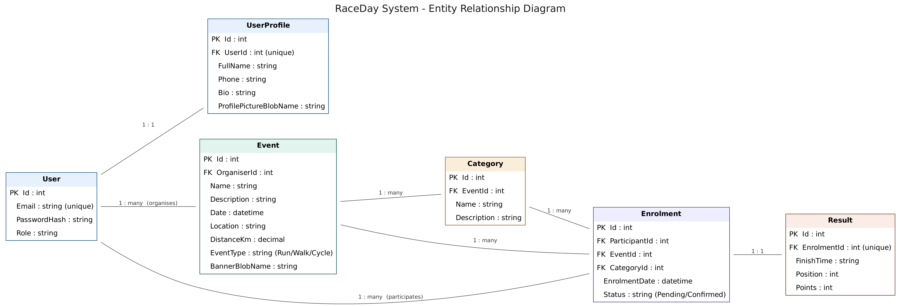
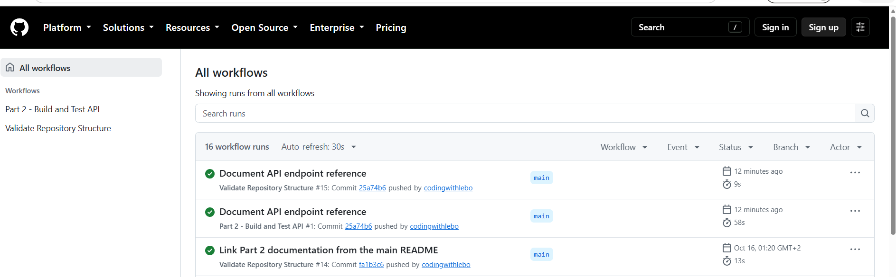

# RaceDay — Race Event Management System

A web-based race event management system developed as part of the **PROG6212 Portfolio of Evidence (POE)**. RaceDay provides functionality for event organisers to manage race events and for participants to discover events, enrol and access their event information.

The project is developed across three parts, covering system planning and database design, RESTful API development, and an MVC web application.

---

## Table of Contents

- [Project Overview](#project-overview)
- [Project Objectives](#project-objectives)
- [Project Structure](#project-structure)
- [Technology Stack](#technology-stack)
- [System Architecture](#system-architecture)
- [User Roles](#user-roles)
- [Database Design](#database-design)
- [Part 1 — System Planning and Database](#part-1--system-planning-and-database)
- [Part 2 — RESTful API](#part-2--restful-api)
- [Part 3 — MVC Web Application](#part-3--mvc-web-application)
- [Installation and Setup](#installation-and-setup)
- [Running the Applications](#running-the-applications)
- [Image Storage](#image-storage)
- [Docker](#docker)
- [GitHub Actions](#github-actions)
- [Testing and Validation](#testing-and-validation)
- [Screenshots and Demonstration](#screenshots-and-demonstration)
- [Future Improvements](#future-improvements)

---

## Project Overview

RaceDay is designed to provide a centralised platform for managing race events.

The system supports two primary user roles:

- **Organisers:** Manage race events and related information.
- **Participants:** Browse available events and interact with event enrolment functionality.

The solution follows a layered development approach, separating database management, API functionality and the web interface.

## Project Objectives

The main objectives are to:

1. Design a relational database to support race event management.
2. Develop a RESTful API to handle application data and business operations.
3. Implement authentication and role-based functionality.
4. Develop an MVC web application for organisers and participants.
5. Support event banner and profile picture uploads.
6. Apply containerisation using Docker.
7. Use GitHub Actions to automate repository validation and applicable development checks.

---

## Project Structure

The repository is organised into documentation, database resources, API development and MVC application components.

```text
23019520/
│
├── .github/
│   └── workflows/
│       └── validate-structure.yml
│
├── docs/
│   ├── raceday_erd.png
│   ├── api-endpoint-plan.md
│   ├── raceday-schema.sql
│   └── ci-green-build.png
│
├── part2/
│   ├── RaceDay.Api/
│   │   ├── Controllers/
│   │   ├── Services/
│   │   ├── wwwroot/
│   │   ├── Dockerfile
│   │   └── RaceDay.Api.csproj
│   │
│   └── README.md
│
├── part3/
│   ├── RaceDay.Web/
│   │   └── RaceDay.Web.csproj
│   │
│   └── README.md
│
├── .gitignore
└── README.md
```

*Note: The structure above highlights the main project components. Additional source files and folders are maintained within the individual application projects.*

---

## Technology Stack

| Technology | Purpose |
|---|---|
| C# | Application development |
| ASP.NET Core Web API | Backend API |
| ASP.NET Core MVC | Web application |
| SQL Server | Relational database |
| Entity Framework Core / SQL access | Database interaction, as implemented |
| Swagger / OpenAPI | API documentation and testing |
| HTML, CSS and JavaScript | Web interface |
| Docker | Application containerisation |
| GitHub Actions | Automated repository validation |

---

## System Architecture

RaceDay separates the application into three main components:

**1. Database layer**

SQL Server stores the application's structured information, including users, profiles, events, categories, enrolments and results.

**2. API layer**

The ASP.NET Core Web API handles application requests, processes business operations and communicates with the database.

**3. Presentation layer**

The ASP.NET Core MVC application provides the user-facing interface. It communicates with the API to retrieve and submit application information.

This separation improves maintainability and allows the presentation layer and backend functionality to be developed independently.

---

## User Roles

### Organiser

The Organiser role supports event management functionality, including:

- Creating race events.
- Managing event information.
- Managing event categories, where supported.
- Viewing and managing event enrolments.
- Accessing organiser-specific functionality.

Organiser registration uses an invitation mechanism where configured.

### Participant

The Participant role supports:

- Creating an account.
- Logging into the system.
- Browsing available race events.
- Viewing event information.
- Enrolling in events.
- Accessing participant-specific information.

Access to functionality is controlled according to the implemented authentication and authorisation rules.

---

## Database Design

The RaceDay database is designed around six main entities:

| Entity | Description |
|---|---|
| User | Stores account and authentication information. |
| UserProfile | Stores additional user profile information. |
| Event | Stores race event information and its organiser relationship. |
| Category | Stores categories associated with events. |
| Enrolment | Records participant enrolments. |
| Result | Stores results associated with enrolments. |

### Entity Relationship Diagram

The database relationships are represented in the RaceDay Entity Relationship Diagram.



### Key relationships

- A User can have an associated UserProfile.
- An Organiser can manage multiple Events.
- An Event can contain multiple Categories.
- A Participant can have multiple Enrolments.
- An Event can have multiple Enrolments.
- Each Enrolment is associated with an Event Category.
- An Enrolment can have an associated Result.

Primary keys uniquely identify records, while foreign keys maintain relationships and referential integrity.

### Database script

The SQL database script is located at:

`docs/raceday-schema.sql`

It contains the database creation and population instructions for the planned RaceDay schema.

---

## Part 1 — System Planning and Database

Part 1 establishes the foundation for the RaceDay system.

Deliverables include:

- Entity Relationship Diagram.
- Relational database schema.
- SQL database creation and sample data script.
- REST API endpoint specification.
- Project documentation.
- GitHub Actions repository validation.

### Planning documentation

| File | Description |
|---|---|
| `docs/raceday_erd.png` | Database Entity Relationship Diagram |
| `docs/api-endpoint-plan.md` | REST API endpoint specification |
| `docs/raceday-schema.sql` | SQL database script |

---

## Part 2 — RESTful API

Part 2 implements the backend functionality using ASP.NET Core Web API.

The API provides endpoints for interacting with the RaceDay system.

### Main API functionality

- Authentication and user registration.
- User profile management.
- Event management.
- Event searching and filtering.
- Category functionality.
- Participant enrolments.
- Result-related functionality.
- Event banner and profile picture handling.
- Role-based access control.

### Swagger documentation

Swagger provides an interactive interface for exploring and testing the API.

When the API is running locally, access:

`http://localhost:5080/swagger`

The Swagger interface allows developers to:

- View available API endpoints.
- Inspect request parameters.
- Submit GET, POST, PUT and DELETE requests where supported.
- Review HTTP response codes.
- Inspect returned JSON data.

### Part 2 documentation

See [`part2/README.md`](part2/README.md) for the API-specific setup instructions, implementation details and additional documentation.

---

## Part 3 — MVC Web Application

Part 3 implements the RaceDay presentation layer using ASP.NET Core MVC.

The web application provides an interface through which users interact with the RaceDay API.

### Main functionality

- User registration and login.
- Organiser and Participant experiences.
- Event browsing and event information.
- Organiser event management.
- Participant functionality.
- Event banner and profile picture support.
- Communication with the backend API.

### Running the MVC application

From the repository root, open PowerShell and execute:

```powershell
cd part3\RaceDay.Web
dotnet run
```

Open the local address displayed in the terminal.

For the current development launch configuration, the application runs at:

`http://localhost:5200`

### Part 3 documentation

See [`part3/README.md`](part3/README.md) for additional MVC setup and implementation information.

---

## Installation and Setup

### Prerequisites

Install the following development tools:

- .NET SDK compatible with the project target framework.
- Microsoft SQL Server.
- SQL Server Management Studio (SSMS).
- Visual Studio or Visual Studio Code.
- Docker Desktop (for containerisation).
- Git.

### 1. Clone the repository

```bash
git clone <YOUR-GITHUB-REPOSITORY-URL>
```

Navigate into the project directory:

```bash
cd 23019520
```

### 2. Set up the database

1. Open SQL Server Management Studio.
2. Connect to your SQL Server instance.
3. Open `docs/raceday-schema.sql`.
4. Execute the script.
5. Verify that the expected database tables and sample data have been created.

Example verification queries:

```sql
SELECT * FROM [User];
SELECT * FROM UserProfile;
SELECT * FROM Event;
SELECT * FROM Category;
SELECT * FROM Enrolment;
SELECT * FROM Result;
```

Use the database name and connection settings configured for the API.

### 3. Configure the API

Navigate to the API project:

```powershell
cd part2\RaceDay.Api
```

Configure the database connection using the application's supported configuration or user-secrets mechanism.

Do not commit database passwords, connection strings containing credentials, or other sensitive configuration to GitHub.

### 4. Start the API

```powershell
dotnet run --launch-profile http --urls "http://0.0.0.0:5080"
```

Open Swagger:

`http://localhost:5080/swagger`

### 5. Start the MVC application

Open a second terminal:

```powershell
cd part3\RaceDay.Web
dotnet run
```

Open the URL displayed by the application.

Keep the API running while using the MVC application.

---

## Running the Applications

During local development, the applications run separately.

| Application | Local address |
|---|---|
| RaceDay API | `http://localhost:5080` |
| Swagger UI | `http://localhost:5080/swagger` |
| RaceDay MVC | `http://localhost:5200` |

The MVC application depends on the API being available at its configured API base address.

If the applications use different ports in another environment, use the addresses displayed by their respective launch configurations.

---

## Image Storage

The current implementation uses local file storage under the API's `wwwroot` directory.

Uploaded event banners and profile pictures are saved in the application's upload directories.

The local storage implementation allows uploaded images to be managed by the API without requiring an external cloud storage account.

**Storage implementation note:** Local `wwwroot` storage is the current configured approach. Azure Blob Storage should not be considered an active deployment dependency unless it is separately configured and tested.

---

## Docker

Docker support is included for containerising the API.

The API Dockerfile is located at:

`part2/RaceDay.Api/Dockerfile`

### Requirements

- Docker Desktop installed and running.
- A configured SQL Server database.
- A valid database connection configuration.

### Build the API image

From PowerShell:

```powershell
cd part2\RaceDay.Api
docker build -t raceday .
```

### Run with SQL Server in Docker

The following is an example development setup using a Docker network.

First, create the network:

```powershell
docker network create raceday-net
```

Run SQL Server:

```powershell
docker run -d --name raceday-sql `
  --network raceday-net `
  -e ACCEPT_EULA=Y `
  -e "MSSQL_SA_PASSWORD=$env:SA_PASSWORD" `
  -p 1433:1433 `
  mcr.microsoft.com/mssql/server:2022-latest
```

Set a strong development password in the `SA_PASSWORD` environment variable before running the command.

Run the API container:

```powershell
docker run --rm --network raceday-net -p 8080:8080 `
  -e "ConnectionStrings__RaceDayDb=Server=raceday-sql,1433;Database=RaceDay;User Id=sa;Password=$env:SA_PASSWORD;TrustServerCertificate=True" `
  raceday
```

The database name and connection string must match the database configuration and initialisation approach used by the application.

When the API container is running, access its Swagger interface at:

`http://localhost:8080/swagger`
### Docker Demonstration

The following screenshots demonstrate the RaceDay API running in a Docker environment.

**Swagger running in Docker**


**Docker implementation screenshots**


After starting the containers, allow time for SQL Server to initialise before accessing the API.

Swagger is available at:

`http://localhost:8080/swagger`


*The Docker configuration should be tested against the current database initialisation process before relying on these commands in another environment.*

---

## GitHub Actions

GitHub Actions is used to automate repository validation.

The workflow is located at:

`.github/workflows/validate-structure.yml`

The repository validation workflow checks for required project resources, including:

- The documentation directory.
- The ERD file.
- The API endpoint plan.
- The SQL schema script.
- The README file.
- Required documentation content.

The successful workflow execution confirms that the configured repository structure validation checks have passed.




## GitHub Actions

GitHub Actions is used to automate repository validation and ensure that the required project structure and documentation files are present.

The workflow is located at:

`.github/workflows/validate-structure.yml`

### Workflow execution screenshots

**Successful GitHub Actions build**


**Additional GitHub Actions screenshot**


The workflow should be understood as repository validation; it does not by itself establish that every application feature or deployment has passed automated testing.

---

## Testing and Validation

The project uses different validation approaches throughout development.

### API validation

Swagger is used to test API endpoints, inspect request parameters and review HTTP responses.

### Database validation

SQL Server Management Studio is used to inspect database tables, relationships and sample records.

### Application validation

The MVC application is run locally to verify the user-facing functionality and its communication with the API.

### Repository validation

GitHub Actions checks the presence and content of required repository deliverables.

---

## Screenshots and Demonstration

Project screenshots and demonstration recordings provide visual evidence of the implementation.

Recommended evidence includes:

- Database and ERD.
- Swagger interface and API responses.
- MVC homepage.
- Registration and login.
- Organiser functionality.
- Participant functionality.
- Docker build and container execution.
- Successful GitHub Actions workflow.

### Video demonstrations

**Part 1 — Planning and Database*
(https://youtu.be/Zdhd0I0u4us)


## Video Demonstration — Parts 2 and 3

The following video provides a combined demonstration of the RaceDay RESTful API (Part 2) and MVC Web Application (Part 3).

The demonstration includes the Swagger interface, API endpoint testing, and the MVC application with its available user functionality.

[Watch the RaceDay Parts 2 and 3 Demonstration](https://youtu.be/DpA99m9e8uI)

(https://youtu.be/DpA99m9e8uI)

---

## Future Improvements

Possible future enhancements include:

- Cloud-based image storage using Azure Blob Storage.
- Improved automated unit and integration test coverage.
- Enhanced API monitoring and logging.
- Production deployment and hosting.
- Improved application security and configuration management.
- Additional reporting and event analytics.
- More comprehensive accessibility and responsive design improvements.

---

## Part 1 Deliverables

The repository includes the following Part 1 planning and database resources:

- [x] Entity Relationship Diagram.
- [x] REST API endpoint specification.
- [x] SQL database creation and sample data script.
- [x] README documentation.
- [x] GitHub Actions repository validation workflow.
- [x] Successful repository validation.

Part 2 and Part 3 extend the original planning and database foundation into a working backend API and MVC web application.

---

## Author and Project Information

**Project:** RaceDay — Race Event Management System  
**Module:** PROG6212  
**Project:** Portfolio of Evidence (POE)


