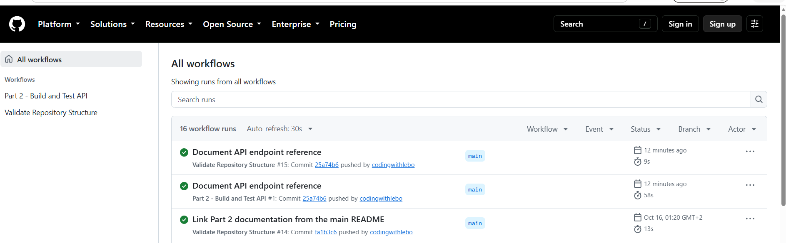

# RaceDay Web — Part 3

ASP.NET Core MVC front end for the RaceDay platform. It consumes the Part 2 API for **every** data operation, with no database access and no replicated business logic. Azure Blob Storage is integrated into the API, so the MVC app never talks to Azure. It runs in Docker.

## How it fits together

```
Browser  ->  RaceDay.Web (MVC, port 5200 or Docker 8080)  ->  RaceDay.Api (port 5080)  ->  SQL Server
                                                                       \->  Azure Blob Storage (images)
```

- **No database in MVC.** `Services/ApiClient.cs` is the only way the web app reaches data. Controllers call it and render the results.
- **Session management.** Logging in calls `POST /api/auth/login`. The MVC app keeps the user's id, name and role in its own server-side session, together with the API session cookie, which it forwards on every API call. The role drives the navigation and the page guards. Logging out ends both sessions and redirects to the home page.
- **Role-based interfaces.** `[SessionAuthorize("Organiser")]` and `[SessionAuthorize("Participant")]` guard the pages. Anonymous visitors are sent to the login page, and the wrong role is sent to an access-denied page. The API enforces the same rules independently.
- **Images through the API.** Banners and profile pictures are uploaded to the API, which stores them in Azure Blob Storage. The browser loads them from `Media/EventBanner/{id}` and `Media/ProfilePicture/{id}`, which fetch the bytes from the API.

## Pages

| Role | Page | What it does |
|---|---|---|
| Everyone | Events (home) | Upcoming events with search, type and distance filters |
| Everyone | Event details | Full information, banner and categories, plus an enrol form for Participants |
| Everyone | Register / Log in | Choose Participant or Organiser (Organisers need the invite code) |
| Participant | My enrolments | Events they entered, with colour-coded status: **green = Confirmed**, **amber = Pending**, and cancel |
| Participant | My results | Event name, date, category, finish time and position, for example "47th out of 312 finishers" |
| Both | Profile | View and update details, and upload a profile picture |
| Organiser | Dashboard | Events created, upcoming events, total enrolments and enrolments per event |
| Organiser | My events / Create / Edit | Manage events with name, description, date, location, distance, type and banner upload |
| Organiser | Categories | Add age or distance categories for an event |
| Organiser | Enrolments | See who entered, their category and status, and confirm enrolments |
| Organiser | Results | Capture finish times and positions, which are published to participants when saved |

Invalid input never shows a raw error: forms validate on the server and show friendly messages, API failures become readable alerts, and unexpected errors land on a styled error page.

## Run it locally

1. Start the API from `part2/RaceDay.Api` (it needs your SQL Server and, for images, the Azure connection string; see `part2/README.md`):
   ```
   dotnet run --launch-profile http --urls "http://0.0.0.0:5080"
   ```
2. In a second terminal, start the web app:
   ```
   cd part3/RaceDay.Web
   dotnet run
   ```
3. Open http://localhost:5200. Register an Organiser (using the invite code) in one browser and a Participant in another (or a private window) to see both interfaces.

The API address is read from `Api:BaseUrl` in `appsettings.json` (default `http://localhost:5080`).

## Run it in Docker

With the API running as in step 1 above, one command builds and starts the web app:

```
cd part3
docker compose up --build
```

Then open http://localhost:8080. The container reaches the API on your machine through `host.docker.internal:5080`.

Without Compose, the same thing as a build and run pair:

```
docker build -t raceday-web part3/RaceDay.Web
docker run --rm -p 8080:8080 -e Api__BaseUrl=http://host.docker.internal:5080 raceday-web
```

The Dockerfile uses a multi-stage build (SDK image to build, the smaller ASP.NET runtime image to run), restores dependencies in their own cached layer, publishes in Release mode, runs as a non-root user and listens on port 8080. The containerised app behaves the same as the local one because all behaviour lives in the code and the API.

## CI/CD

`.github/workflows/part2-ci.yml` restores, builds and tests the whole solution, which now includes this MVC project, and then builds the Docker image on every push.



## Video

YouTube (unlisted): _add link here_

## Notes

- The brief's API additions for this part (enrolment status, image upload endpoints, richer results, organiser dashboard, event filters) are documented in the "Changes in revision 3" section of `docs/api-endpoint-plan.md`.
- Static assets (Bootstrap) are bundled in `wwwroot/lib`, so the app needs no internet access at runtime.
